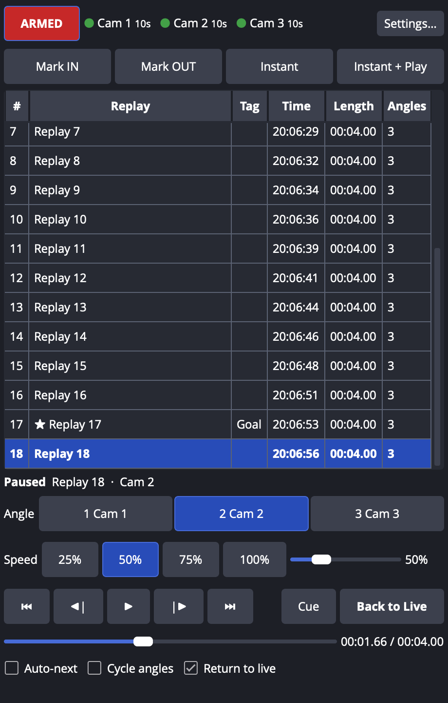
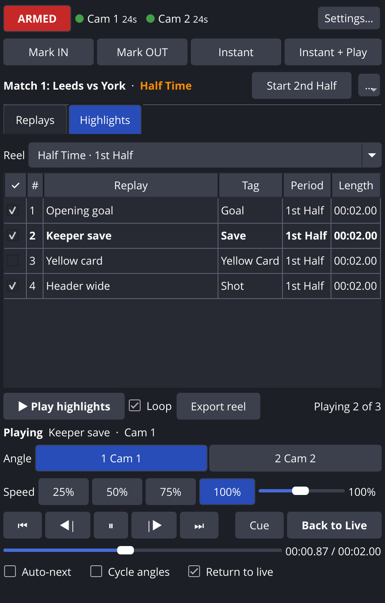
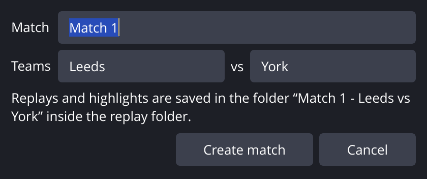
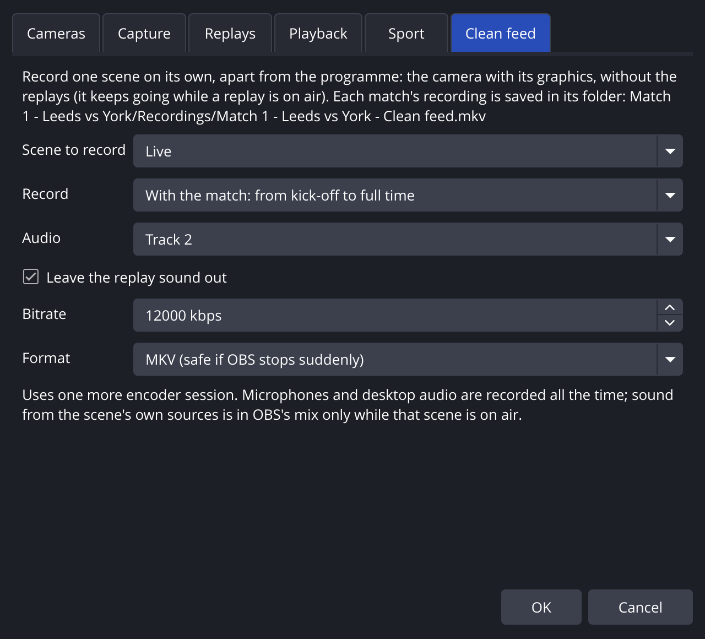

# Replay Cue for OBS Studio

Multi-angle instant replay inside OBS: every camera gets its own rolling replay
buffer, replays land in a cue list, and you play them back on a dedicated
Replay scene with frame-synced angle switching, slow motion and your own
transitions. Inspired by the vMix Replay workflow, built natively for OBS.



## What it does

- **Per-camera replay buffers.** Each angle (up to 8) is rendered off-screen,
  encoded with your hardware encoder and kept in memory for the last N seconds.
  The OBS Replay Buffer only records the program feed; Replay Cue records every
  camera separately.
- **Frame-accurate multi-angle sync.** All angles are stamped on OBS's own video
  clock, so the same moment lines up frame-for-frame across cameras. Switch
  angles mid-replay and the picture changes on the very same frame.
- **Mark IN / Mark OUT** or one-press **Instant Replay** (last N seconds), with
  optional operator-delay compensation.
- **Replay cue list:** name, tag (Goal, Foul, …), favorite, length, angle count.
  Double-click to play, multi-select to play a sequence.
- **Playback on a Replay scene** with your choice of transition in and out
  (stinger, fade, anything), automatic **return to live**, **auto play next**,
  and **cycle angles** (show the replay from every camera in turn).
- **Slow motion** at 25/50/75% or any speed from 5–200%, frame stepping,
  scrubbing, pause, cue (load paused, in Preview when using Studio Mode).
  **Slow-motion audio** is time-stretched so crowd noise and voices keep their
  pitch (or slowed down like tape, or silent: your choice).
- **HDR:** on an HDR canvas (Rec. 2100 PQ/HLG) cameras are recorded in 10-bit
  HDR with an HEVC or AV1 encoder, and replays play back in HDR.
- **Folder import:** clips dropped into the replay folder become replays, and
  multi-angle files are grouped automatically (`Cam1/goal.mp4` + `Cam2/goal.mp4`,
  or `goal_Cam1.mp4` + `goal_Cam2.mp4`). Clips saved by the OBS Replay Buffer
  are added too.
- **Export for social:** one angle or all angles, trimmed IN→OUT or full,
  as web-ready MP4 (no re-encode).
- **Sports and highlights:** pick your sport (football, rugby, AFL, netball,
  basketball and more) and every replay is stamped with the half, quarter or
  period it was saved in. At Half Time and Full Time a **Highlights** tab has the
  reel ready to roll (or rolls it by itself), **fades each replay into the
  next**, can loop it through the break, and **exports the reel as one MP4** for
  social media.
- **Matches:** name each match and its teams ("Match 1: Leeds vs York"). Its
  replays and exported highlights get their own folder, and the replay list
  shows that match's replays.
- **Clean feed:** record your live scene (camera and graphics) on its own for
  the whole match, without the replays, into the match's folder.
- **Control surfaces:** 35 OBS hotkeys and 50 obs-websocket requests for
  Stream Deck, Bitfocus Companion, Touch Portal or your own scripts.

## Requirements

- OBS Studio **32.2** or newer within the 32.x series (the plugin uses the
  FFmpeg libraries that ship inside OBS and must match their version; it checks
  at load time and disables recording/playback with a clear message if not).
- Windows 10/11 x64, macOS 13+ (Apple Silicon or Intel), or Ubuntu 24.04+.
- A hardware video encoder is strongly recommended for more than one camera
  (NVIDIA NVENC, Intel Quick Sync, AMD AMF, Apple VideoToolbox). Each camera
  uses one encoder session; consumer NVIDIA cards cap concurrent sessions
  (your stream and recording count too).
- RAM for the buffers: cameras × bitrate × buffer length. 4 cameras at
  25 Mbps with a 2-minute buffer ≈ 1.4 GB. The settings dialog shows the
  estimate.
- The clean feed recording uses one more encoder session.
- HDR recording needs an HDR canvas (Settings → Advanced → Video in OBS) and an
  encoder that does 10-bit HEVC or AV1 (NVENC, AMF, Quick Sync, Apple
  VideoToolbox); *Automatic* picks one. Otherwise cameras are recorded in SDR.

## Install

Download the package for your platform from the
[Releases page](https://github.com/MalakaiCS/MatchFrame-OBS-Replay-Cue/releases)
(or build it, see below), then:

| Platform | Install |
|---|---|
| Windows | Extract the `.zip` into `C:\ProgramData\obs-studio\plugins\` (you should end up with `…\plugins\obs-replay-cue\bin\64bit\obs-replay-cue.dll`) |
| macOS | Open the `.pkg`, or copy `obs-replay-cue.plugin` into `~/Library/Application Support/obs-studio/plugins/` |
| Linux | Install the `.deb` |

The macOS package is only signed and notarized if you add Apple signing
secrets to the GitHub repository (see the template's documentation);
otherwise right-click → Open the first time.

Restart OBS and open **Docks → Replay Cue**.

## Quick start

1. **Docks → Replay Cue → Settings… → Cameras.** Add each camera source (or a
   scene that shows it). "Add all cameras" picks up capture cards, webcams,
   NDI and media sources automatically. Give each a short label (Cam 1, Wide,
   Baseline…).
2. **Capture tab.** Pick the encoder (Automatic prefers hardware), bitrate,
   buffer length and audio track. Optionally tick *Start recording replay
   buffers when OBS starts*.
3. **Playback tab.** Choose the transition into replays (e.g. your stinger) and
   back to live. Replay Cue creates a **Replay** scene with a **Replay Cue
   Player** source the first time you play; put your replay graphics on top
   of it.
4. Press **Arm**. The chips turn green as each camera's buffer fills.
5. During the game: press **Instant** (or Mark IN → Mark OUT). A new replay
   appears in the list with every angle.
6. **Instant + Play** (or double-click a replay) puts it on air. Press **1–8**
   to switch angles, **25/50/75%** for slow motion, **Back to Live** when done
   (or let it return automatically).

## Sports and highlights



Highlights packages keep viewers watching through the breaks. Replay Cue
builds them as you go:

1. **Settings… → Sport.** Pick your sport. It sets the match structure and the
   quick tags (Goal, Try, Behind, Mark…):

   | Sport | Periods | Breaks with a highlights reel |
   |---|---|---|
   | Football (soccer), rugby union, rugby league, Gaelic football / hurling | 2 halves | Half Time, Full Time |
   | Australian rules (AFL), netball, hockey | 4 quarters | Quarter Time, Half Time, Three-Quarter Time, Full Time |
   | Basketball, American football | 4 quarters | End of Q1, Half Time, End of Q3, Full Time |
   | Ice hockey | 3 periods | 1st and 2nd Intermission, Full Time |

2. **Create the match.** **New match…** on the match bar asks for the match
   name and the two teams (*Match 1*, *Leeds* vs *York*). The match gets its
   own folder in the replay folder, `Match 1 - Leeds vs York`, and every
   replay of the match and its exported highlights are saved there. The
   Replays tab lists the open match's replays.

   

3. **Run the match from the dock.** The match bar above the replay list shows
   the match and where it is, and moves it on: *Start 1st Half* → *Half Time*
   → *Start 2nd Half* → *Full Time*. Every replay is stamped with the period it
   was saved in. A replay saved during a break belongs to the period that just
   ended, so the late replay of a goal on the whistle still makes it in.
4. **At the break, roll the reel.** Calling a break opens the **Highlights**
   tab on that break's reel. Half Time covers the first half, Full Time the
   whole match, and other breaks the period that just finished. Replays are
   in the reel unless you untick them; tick or untick any time (or press **H**
   on a replay in the list). **Play highlights** plays them oldest first,
   from the selected angle, at the highlights speed (100% by default), with
   *Cycle angles* if it is on. Each replay **fades into the next** (picture
   dissolve, the sound dips) instead of cutting; set the length, or *Cut*, in
   Settings → Sport → *Fade between replays* (0.5 s by default). ⏮/⏭ step
   through the reel. With **Loop** on, the reel repeats until you press
   **Back to Live**, so it can fill the whole break.
5. **Or let it roll by itself.** Tick *Play the highlights automatically when
   a break starts* in Settings → Sport. Calling the break puts its reel on air
   after the delay you choose (5 s by default). A replay already on air is
   never cut off: the reel follows straight on from it. **Back to Live**
   cancels a reel that has not started yet.
6. **Post it.** **Export reel** saves the ticked replays as one MP4 in the
   match's `Highlights` folder (`Match 1 - Leeds vs York - Full Time
   highlights.mp4`), from the selected angle, ready for social media. The clips are joined without re-encoding, so it
   takes seconds and does not load the computer during the broadcast. A clip
   that cannot be joined to the others (a different camera size or codec, such
   as an imported file) is left out and named in the message.
7. **Give highlights their own look (optional).** Set a *Highlights scene* in
   Settings → Sport and reels play there instead of on the Replay scene. Add a
   "HALF TIME HIGHLIGHTS" graphic to it. The scene is created with the player
   the first time a reel plays.

**New match…** (on the match bar at Full Time, or in its … menu) starts the
next game in a new folder, with an empty replay list and empty reels. The …
menu also has:

- **Edit match…** to fix the name or the teams (the folder is renamed to
  match, unless a replay is playing from it).
- **Open match** to go back to an earlier match: its replays, its reels and
  how far it got, for example to export its Full Time highlights later. New
  replays then go into that match.
- **Show replays from all matches** to list every match's replays at once.
- The match phases, to jump to any part of the match if you called a break by
  mistake.

Pressing *Start 1st Half* without creating a match opens the next "Match N";
name it afterwards with Edit match. A replay's right-click **Period** menu moves
it to another period. Without a sport there are no matches, and the Highlights
tab has a single *All highlights* reel.

## Clean feed recording



The programme (your stream and OBS's own recording) has the replays cut into
it. The clean feed is a second recording of just your live scene, the camera
with its graphics, which keeps going while a replay is on air. Use it for the
full match video, or to cut your own edit later.

1. **Settings… → Clean feed.** Pick the scene to record (for example *Live*).
   The Replay and highlights scenes are not offered.
2. **Choose when it records:**
   - *With the match*: from *Start 1st Half* to *Full Time*, through the
     breaks, one file per match. If OBS is restarted mid-match it carries on
     in a new file.
   - *While the cameras are armed*: whenever Replay Cue is armed.
   - *Only with the REC button*.

   The **● REC** button in the dock (and the *Start / stop clean feed
   recording* hotkey) starts or stops it by hand in any mode, and shows how
   long it has been recording.
3. **Sound.** Pick the OBS audio track to record (track 2 by default). With
   *Leave the replay sound out* on, the Replay Cue Player is taken off that
   track (OBS → Edit → Advanced Audio Properties), so replays are not heard in
   the clean feed; tick the track there again if you turn the option off. Keep
   your stream on another track (normally track 1), or the replays would be
   silent on the stream too; the settings warn you.

Each match's clean feed is saved in its folder:
`Match 1 - Leeds vs York/Recordings/Match 1 - Leeds vs York - Clean feed.mkv`
(numbered `(2)`, `(3)`… if you record again). Without a match it goes in
`Recordings/Clean feed <date>.mkv` in the replay folder. MKV is the default;
MP4 is written fragmented, so either is safe if OBS stops suddenly. The picture
is the canvas at OBS's output size, recorded with the camera encoder (HDR on an
HDR canvas).

## Operator controls

### Dock keyboard (while the dock has focus)

| Key | Action |
|---|---|
| Space | Play / pause |
| Enter | Play selected replay |
| Esc | Back to live |
| 1–8 | Switch angle |
| ← / → | Step one frame |
| I / O | Mark IN / Mark OUT |
| H | Add to / remove from highlights |
| F2 | Rename |
| Delete | Delete selected (moves files to the Trash) |

### OBS hotkeys (Settings → Hotkeys, search "Replay Cue")

Arm/disarm, Mark IN, Mark OUT, Save instant replay, Save instant replay and
play, Cue selected, Play selected, Play latest, Play/pause, Restart, Back to
live, Next/previous angle, Angle 1–8, Speed 25/50/75/100%, Step back/forward,
Select previous/next replay, Play previous/next replay, Next match period /
break, Play highlights, Add / remove selected replay in highlights, Start /
stop clean feed recording.

Bindings are stored in the plugin's own config and survive scene-collection
changes.

## Stream Deck, Companion and scripts (obs-websocket)

Replay Cue registers the obs-websocket vendor **`ReplayCue`**. Send
`CallVendorRequest` with `vendorName: "ReplayCue"`:

```json
{
  "requestType": "CallVendorRequest",
  "requestData": {
    "vendorName": "ReplayCue",
    "requestType": "InstantReplay",
    "requestData": { "seconds": 8, "play": true }
  }
}
```

In **Bitfocus Companion**, use the OBS module's *Custom Command* /
*Vendor Request* action. On a **Stream Deck** without Companion, bind keys to
the OBS hotkeys above, or use a websocket plugin that can send raw requests.

| Request | Data | What it does |
|---|---|---|
| `GetStatus` | – | Armed state, per-camera buffer, marks, playback state, options, clean feed (`recording`, `file`, `seconds`) |
| `GetEvents` | – | Replay list as the dock shows it: the open match's replays (id, name, tag, angles, duration, index) |
| `Arm` / `Disarm` / `ToggleArm` | – | Start/stop the camera buffers |
| `MarkIn` / `MarkOut` / `ClearMarks` | – | Mark a replay; OUT saves it |
| `InstantReplay` | `seconds?`, `play?` | Save the last N seconds (and play it) |
| `SelectEvent` | `id` or `index` | Select in the list (`index` is 1-based; -1 = latest) |
| `CueEvent` | `id`/`index`? | Load paused on the first frame (selected if omitted) |
| `PlayEvent` | `id`/`index`?, `angle?`, `speed?` | Play a replay on air |
| `PlaySelected` / `PlayLatest` / `PlayNext` / `PlayPrevious` | – | Play from the list |
| `PlayQueue` | `ids: [{id}]` | Play several replays back to back |
| `PlayPause` / `Pause` / `Resume` / `Restart` | – | Transport |
| `ReturnToLive` (alias `Stop`) | – | Transition back to the live scene |
| `SetAngle` | `angle` (1-based) or `label` | Switch camera angle |
| `NextAngle` / `PrevAngle` | – | Cycle angles |
| `SetSpeed` | `speed` (0.05–2.0) or `percent` | Slow motion |
| `Seek` | `position` (s) | Jump within the replay |
| `Step` | `frames` (±n) | Frame step |
| `SetOptions` | `autoPlayNext?`, `cycleAngles?`, `returnToLive?`, `autoHighlights?`, `highlightsFade?` (seconds, 0 = cut), `showAllMatches?` | Toggle behaviour |
| `RenameEvent` / `SetEventTag` / `ToggleFavorite` | `id`/`index`, `name`/`tag` | Edit a replay |
| `DeleteEvent` | `id`/`index` | Move a replay's files to the Trash |
| `ExportEvent` | `id`/`index`?, `angle?`, `trim?` (default true) | Export MP4s to the export folder |
| `RefreshEvents` | – | Rescan the replay folder |
| `GetMatch` | – | The open match (title, name, teams, folder), sport, current phase, every phase, and each highlights reel (count, length, replay ids) |
| `NextMatchPhase` | – | Move the match on (start a period, call a break or full time) |
| `SetMatchPhase` | `phase` (0 = pre-match) | Jump to a phase (numbers from `GetMatch`) |
| `NewMatch` | `name?`, `home?`, `away?` | Start a new match in its own folder ("Match N" if no name is given) |
| `SetMatchInfo` | `name?`, `home?`, `away?` | Rename the open match or its teams (the ones given change) |
| `GetMatches` | – | Every match in the replay folder (id, title, teams, folder, phase), newest first |
| `OpenMatch` | `id` | Go back to an earlier match |
| `PlayHighlights` | `reel?`, `loop?` | Play a highlights reel (default: the current break's) |
| `ExportHighlights` | `reel?`, `angle?` | Save a highlights reel as one MP4 in the match's `Highlights` folder |
| `SetHighlight` | `id`/`index`?, `highlight?` | Put a replay in or out of the highlights (toggles if `highlight` is omitted) |
| `SetEventPeriod` | `id`/`index`, `period` | Move a replay to another period |
| `StartCleanFeed` / `StopCleanFeed` | – | Start or stop the clean feed recording |
| `SaveUiSnapshot` | `folder` | Save PNGs of the dock, the New match dialog and settings (for docs) |

Reels are named by the phase number of their break (`reel: 2` is Half Time in
football; `GetMatch` lists them). Replays in `GetEvents` carry `highlight`,
`period` and `match`.

Vendor events (subscribe to `Vendors`): `ReplayCreated`, `PlaybackStarted`,
`PlaybackEnded`, `PlaybackStopped`, `ArmedChanged`, `MatchChanged` (a match
was created, opened or renamed), `MatchPhaseChanged`, `HighlightsStarted`,
`HighlightsExported` (with the file path, so a script can upload it),
`CleanFeedStarted` and `CleanFeedStopped` (with the file and its length). In a
highlights reel each replay sends `PlaybackStarted` as it fades in.

`tools/replaycue_ws.py` is a dependency-free command-line client:

```bash
python3 tools/replaycue_ws.py InstantReplay '{"seconds": 10, "play": true}'
```

```bash
python3 tools/replaycue_ws.py SetAngle '{"label": "Cam 2"}'
```

The **Replay Cue Player** source also supports OBS's standard media controls,
so `TriggerMediaInputAction` and the source's play/pause/next buttons work too
(next/previous switch angles).

## The replay folder

Each replay Replay Cue records is saved as one MP4 per angle plus a small
sidecar file, in the folder of the match it belongs to:

```
Replays/
  Match 1 - Leeds vs York/
    match.rcmatch.json                   ← match name, teams, sport, how far it got
    2026-10-22_20-00-40_R002_Cam-1.mp4
    2026-10-22_20-00-40_R002_Cam-2.mp4
    2026-10-22_20-00-40_R002_Cam-3.mp4
    2026-10-22_20-00-40_R002.rcue.json   ← name, tag, period, highlight, IN/OUT, per-angle capture time
    Highlights/
      Match 1 - Leeds vs York - Half Time highlights.mp4
      Match 1 - Leeds vs York - Full Time highlights.mp4
    Recordings/
      Match 1 - Leeds vs York - Clean feed.mkv
  Match 2 - Hull vs Bath/
    …
```

Without a sport (or a match), replays are saved in the replay folder itself.

The sidecar stores where IN falls in each file, which is what keeps angles
frame-synced. File paths are relative, so the folder can be copied to another
machine.

Other clips in the folder, in a match's folder (they join that match) or in
camera sub-folders of either are picked up as **imported** replays and grouped
by camera:

- sub-folders named after a camera: `Cam1/goal.mp4`, `Cam2/goal.mp4`
- or a camera token in the file name: `goal_Cam1.mp4`, `goal-cam2.mov`,
  `Goal Angle 3.mkv`

Camera names are your configured labels, or the generic `cam`, `camera`,
`angle`, `view`, `feed`, `iso` followed by a number. Imported clips are aligned
at their first frame. Renaming or tagging an imported replay creates a sidecar
for it.

## Tips

- Keep the keyframe interval at 1 s (default). Replays start on the keyframe
  before IN, and scrubbing/angle seeks decode from the previous keyframe.
- Replays play the audio of the selected angle. In slow motion it is
  time-stretched by default; Settings → Playback → *Slow-motion audio* can make
  it tape-style (lower pitch) or silent.
- Use *Operator delay compensation* if your monitor or multiviewer runs behind
  real time.
- Put a "REPLAY" bug or wipe graphic on the Replay scene above the player.
- In Studio Mode, **Cue** loads a replay paused into Preview; transition it
  live yourself and it starts automatically (configurable).

## Limitations

- Exports start on the keyframe at or before IN (at most one keyframe
  interval early); they are stream copies, not re-encodes. An exported reel
  uses one angle for every replay, cuts from one replay to the next (the fades
  are on air only), and only clips with the same size and codec can be joined.
- HDR is recorded only with a 10-bit HEVC or AV1 encoder; an H.264 encoder on
  an HDR canvas records SDR (Rec. 709).
- A highlights reel cuts, rather than fades, between an HDR and an SDR replay.
- The clean feed's sound is an OBS mixer track. Microphones and desktop audio
  are in it all the time, but OBS mixes a scene's own sources (a camera's
  embedded audio, for example) only while that scene is on air, so they drop
  out of the clean feed during replays.
- Playing many angles decodes all of them at once so switching is instant;
  hardware decoding is on by default.
- Hotkeys are global to the plugin, not per replay. Use `PlayEvent` with an
  index from a control surface to fire specific replays.

## Building from source

The project follows the official
[OBS plugin template](https://github.com/obsproject/obs-plugintemplate).
Pushing to GitHub runs `.github/workflows/push.yaml`, which builds and packages
Windows, macOS and Ubuntu artifacts. Tagging a release (`1.0.0`) creates a
draft GitHub release with the Windows `.zip`, macOS `.pkg` and Ubuntu `.deb`,
using that version's section of `CHANGELOG.md` as the release notes. To
release without pushing a tag, run the **Push** workflow from the Actions tab
on `main` with the version (`1.0.0`): it builds, creates the tag and publishes
the release. `buildspec.json` pins OBS 32.2.2 and the matching obs-deps
(`2026-07-15`).

Local builds use the template presets:

```bash
cmake --preset macos && cmake --build --preset macos
```

```bash
cmake --preset windows-x64 && cmake --build --preset windows-x64
```

```bash
cmake --preset ubuntu-x86_64 && cmake --build --preset ubuntu-x86_64
```

On Ubuntu, install `obs-studio` from the OBS PPA plus `libavcodec-dev
libavformat-dev libavutil-dev libswscale-dev qt6-base-dev` first. The macOS
preset needs full Xcode.

### macOS without Xcode

`tools/macos-dev/build.sh` builds against an installed `OBS.app` using only the
Command Line Tools. Point it at an OBS.app, the matching OBS source tree and
obs-deps/Qt packages (see the script header):

```bash
OBS_APP=/Applications/OBS.app OBS_SOURCE=~/src/obs-studio-32.2.2 OBS_DEPS=~/deps/obs-deps QT_DIR=~/deps/qt6 tools/macos-dev/build.sh --install
```

## License

GPL-2.0-or-later, like OBS Studio. `src/third-party/obs-websocket-api.h` is
from obs-websocket (GPL-2.0-or-later).
